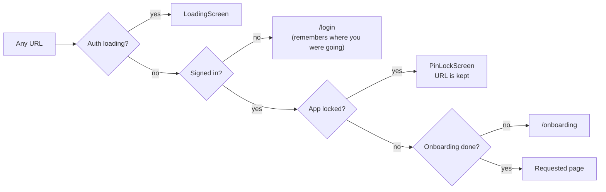
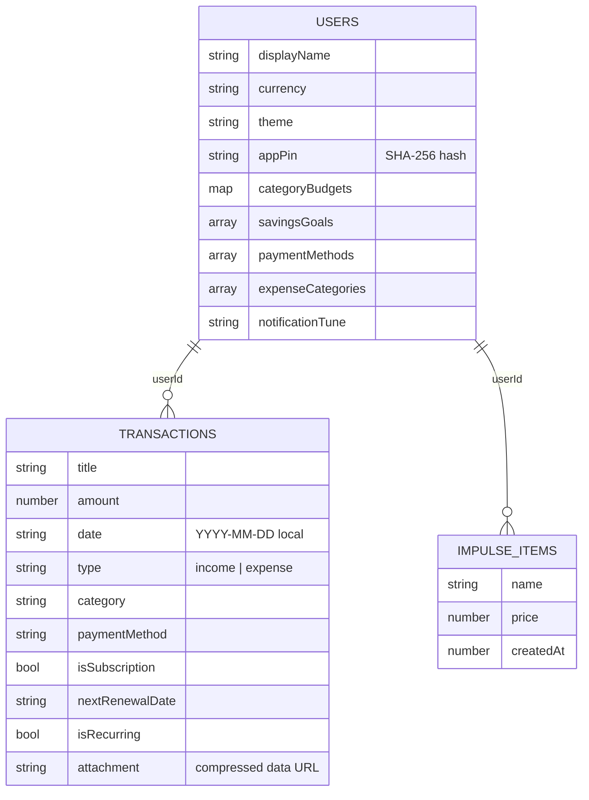
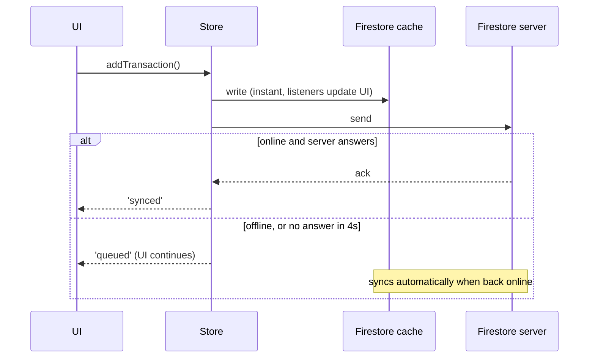
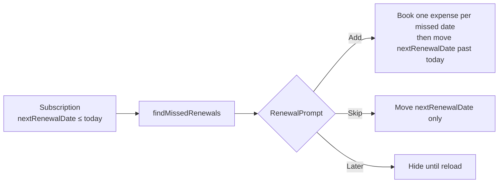
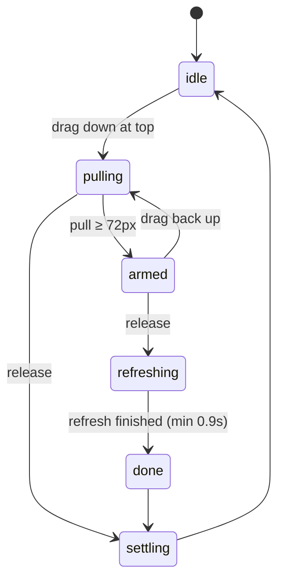

# ExpenseTracker Pro — Developer Guide

> **Start here.** This guide explains what the app does, how the code is organised, how data moves, and what has been changed and why. Sections are collapsible. Click a ▸ to open one. Diagrams render on GitHub, in VS Code (with a Mermaid preview extension) and in most Markdown viewers.

**Last updated:** 22 Nov 2026 (login, avatars, piggy loader, chart animations) · **Branch:** `improve/review-fixes-and-ux`

---

## Contents

1. [Quick start](#1-quick-start)
2. [What the app does](#2-what-the-app-does)
3. [Tech stack](#3-tech-stack)
4. [Folder map](#4-folder-map)
5. [Architecture](#5-architecture)
6. [Routing and guards](#6-routing-and-guards)
7. [Data model (Firestore)](#7-data-model-firestore)
8. [How things work](#8-how-things-work) (offline, renewals, imports, search, PIN, notifications…)
9. [UI system: dialogs, motion, formatting](#9-ui-system)
10. [Testing](#10-testing)
11. [Conventions and rules of thumb](#11-conventions)
12. [Troubleshooting](#12-troubleshooting)
13. [Work log: what changed and why](#13-work-log)
14. [Roadmap / open items](#14-roadmap)

---

## 1. Quick start

```bash
npm install
npm run dev          # http://localhost:3000
```

| Command | What it does |
|---|---|
| `npm run dev` | Dev server on **localhost:3000**. No service worker in dev. |
| `npm run dev:phone` | Dev server on your **Wi-Fi over HTTPS** (`https://<your-ip>:5174`) to test on a phone. Accept the certificate warning once. |
| `npm run build` | Type-checks (`tsc --noEmit`) **then** builds to `dist/`. A type error fails the build. |
| `npm run preview` | Serves `dist/` on localhost:4173. **Use this to test offline / PWA behaviour.** |
| `npm test` | Runs all Vitest tests once. `npm run test:watch` re-runs on save. |
| `npm run typecheck` | Type-check only. |

<details>
<summary><b>Environment variables</b></summary>

Put these in `.env.local` (git-ignored):

| Variable | Used by | Notes |
|---|---|---|
| `VITE_GEMINI_API_KEY` (or `GEMINI_API_KEY`) | [utils/gemini.ts](../utils/gemini.ts) | AI insights, receipt scanning, link reading. **Currently bundled into the client** — see [Roadmap](#14-roadmap). |

Firebase config is in [context/Store.tsx](../context/Store.tsx). The Firebase web `apiKey` is public by design; security comes from Firestore rules.
</details>

<details>
<summary><b>Testing on a phone</b></summary>

1. Phone and computer on the same Wi-Fi.
2. `npm run dev:phone` → open the **Network** URL it prints (e.g. `https://192.168.0.103:5174`).
3. Tap **Advanced → Proceed** on the certificate warning (self-signed, your own machine).
4. **Google sign-in** needs the IP added in Firebase console → Authentication → Settings → **Authorized domains**. Email/password works without it.

**Why HTTPS?** On a plain `http://192.168.x.x` address, browsers disable `crypto.randomUUID`, `crypto.subtle` (PIN hashing), the camera and service workers, all of which the app uses.
</details>

---

## 2. What the app does

A personal finance PWA: log income and expenses, see where money goes, set budgets and goals, track subscriptions, and resist impulse buys.

| Page | URL | Purpose |
|---|---|---|
| Sign in / sign up | `/login` | Animated hero (piggy mascot, floating cards), Sign in / Create account tabs, floating-label fields, password strength, Google + GitHub/Apple/Facebook, Guest mode, reset password. |
| Setup | `/onboarding` | 3 steps: about you (name, gender, **avatar**, age), money basics (currency, balance, income, limit, goal), all set (summary + confetti). |
| Dashboard | `/` | Balance card (period chip, All time / This period), income & expense vs targets, streak, category breakdown, quick add, recent activity. Customisable widgets. |
| Transactions | `/transactions` | Add income/expense (auto-picks category), scan a receipt (Gemini), recent activity. |
| History | `/transactions/history` | Calendar (week/month/year/heatmap), search across all dates, filters, CSV import/export, **Tidy up**. |
| Subscriptions | `/subscriptions` | Recurring bills, detection, reminders. Missed renewals are offered by the **renewal prompt**. |
| Budget & Goals | `/budget` | Category caps, monthly limit, savings goals, AI advisor. |
| Vault | `/vault` | "Impulse vault": park a wish, resist it, count what you saved. |
| Profile | `/settings?section=…` | Account, App Lock, notifications & tone, currency/theme, categories, export/backup, help. |
| Simulator | `/simulator` | "What if" forecast with planned purchases. |
| Split Bill | `/split-bill` | **Preview only** (sample data, not linked in nav). |

**Guest mode**: "Try as guest" on the login screen. Data lives in `localStorage` only and never reaches Firestore.

---

## 3. Tech stack

| Area | Choice |
|---|---|
| UI | React 19 + TypeScript 5.8 |
| Build | Vite 6 |
| Styling | Tailwind (CDN, config inside [index.html](../index.html)) + a few global CSS rules there |
| Routing | React Router 7 (`react-router` package) |
| Data / auth | Firebase 12: Auth + Firestore with **persistent local cache** (offline) |
| PWA | `vite-plugin-pwa` (Workbox `generateSW`), production builds only |
| AI | `@google/genai` (Gemini) |
| Tests | Vitest 3 + Testing Library + jsdom |

---

## 4. Folder map

<details open>
<summary><b>Top level</b></summary>

```text
App.tsx                 Providers only: Router → Store → Dialogs → routes
index.tsx               Mounts React; hides the boot splash; cleans stale service workers in dev
index.html              Tailwind config, global CSS (motion, splash), boot splash markup
routes.ts               Every URL, nav items, page titles
router/                 AppRoutes.tsx (routes + guards) and its tests
context/Store.tsx       Firebase init, auth, all data listeners and actions (the "store")
components/             Pages and widgets
components/ui/          DialogProvider (confirm sheets + toasts)
components/settings/    Grouped-list building blocks for Profile
hooks/                  useCountUp, useOnlineStatus, useFinancialInsight
utils/                  Pure logic (dates, money, search, merchants, renewals, offline…)
constants/              Categories, storage keys, limits
firestore.rules         Security rules (NOT deployed yet — see roadmap)
docs/                   This guide
```
</details>

<details>
<summary><b>utils/ — pure, tested logic (open me)</b></summary>

| File | What it gives you |
|---|---|
| [date.ts](../utils/date.ts) | `toLocalISODate`, `parseLocalDate`, `addInterval` (month-end safe), `formatDisplayDate` ("1 Mar 2027"). **Never** use `toISOString().split('T')[0]` — it shifts days in UTC+ zones. |
| [period.ts](../utils/period.ts) | `getPeriodRange`, `shiftPeriod`, `isInRange` for week/month/year. |
| [transactionStats.ts](../utils/transactionStats.ts) | `sumTotals`, `percentChange` (null when nothing to compare), `formatPercentChange`, `calculateStreak`, `topCategories`, `balancesByPaymentMethod`. |
| [format.ts](../utils/format.ts) | `formatMoney(amount, symbol, { signed, compact })`. Use it for every amount. |
| [currency.ts](../utils/currency.ts) | Supported currencies and `getCurrencySymbol`. |
| [search.ts](../utils/search.ts) | `searchTokens` + `matchesSearch`: every word must match title/note/category/method/type/date/amount. |
| [merchant.ts](../utils/merchant.ts) | Bank-narration cleaner, category guessing (learned from history, then keywords), Tidy-up and payment-method fix suggestions. |
| [renewals.ts](../utils/renewals.ts) | `findMissedRenewals`, `renewalTransaction`. |
| [offline.ts](../utils/offline.ts) | `settleWrite`: don't hang the UI on Firestore writes when offline. |
| [csv.ts](../utils/csv.ts) | CSV export/import helpers with formula-injection guard. |
| [image.ts](../utils/image.ts) | Shrink photos before storing (Firestore docs max 1 MiB). |
| [sounds.ts](../utils/sounds.ts) | Four notification tones generated with Web Audio. |
| [celebrate.ts](../utils/celebrate.ts) | Confetti / coins / hearts bursts. |
| [avatars.ts](../utils/avatars.ts) | 12 built-in avatars drawn as SVG (feminine / masculine / neutral), `presetsFor(gender)`. Add purchased art via `EXTRA_AVATARS`. |
| [password.ts](../utils/password.ts) | `passwordStrength` → score 0–4, label, hint (sign-up form). |
| [notifications.ts](../utils/notifications.ts) | Budget, monthly, daily-reminder checks and system notifications. |
| [gemini.ts](../utils/gemini.ts) / [json.ts](../utils/json.ts) | Gemini client; pull JSON out of model replies. |
</details>

---

## 5. Architecture

```mermaid
flowchart TB
  subgraph Browser
    UI["Pages & widgets<br/>(components/)"]
    Router["AppRoutes<br/>guards + lazy pages"]
    Store["StoreProvider<br/>context/Store.tsx"]
    Dialogs["DialogProvider<br/>confirm + toasts"]
    Utils["utils/ (pure logic)"]
    Cache[("Firestore local cache<br/>IndexedDB")]
    SW["Service worker<br/>(production only)"]
  end
  Firebase[("Firebase Auth<br/>+ Firestore")]
  Gemini[("Gemini API")]

  Router --> UI
  UI -->|useStore()| Store
  UI -->|useDialog()| Dialogs
  UI --> Utils
  Store -->|onSnapshot listeners| Cache
  Cache <-->|sync when online| Firebase
  UI -->|AI features| Gemini
  SW -.->|serves app shell offline| UI
```

**One store, many pages.** `StoreProvider` owns Firebase, listens to the user's documents and exposes state and actions through `useStore()`. Pages never call Firestore directly.

<details>
<summary><b>What's in the store? (open for the full API)</b></summary>

| Group | Members |
|---|---|
| Auth | `user`, `loading`, `login`, `signup`, `googleLogin`, `loginWithProvider`, `logout`, `resetPassword`, `reauthenticate`, `deleteAccount`, `enableDemo`, `isDemo` |
| Data | `transactions`, `impulseItems`, `userSettings` |
| Transactions | `addTransaction`, `updateTransaction` (undefined → field deleted), `deleteTransaction` (+ undo), `restoreTransaction`, `clearAllTransactions` |
| Settings | `updateUserSettings`, `widgets`, `toggleWidget`, `widgetOrder`, `updateWidgetOrder`, `completeOnboarding` |
| App Lock | `isPinSet`, `isAppLocked`, `setAppPin`, `removeAppPin`, `unlockApp`, `lockApp`, `verifyBiometric` |
| Notifications | `notifications`, `addNotification` (plays tone), `markNotificationsRead`, `setNotificationRead`, `deleteNotification`, `clearNotifications` |
| Other | `undoState`, `showUndo`, `clearUndo`, `viewingTransaction`, `generateFinancialAudit`, `exportAllData`, `importAllData` |

Every member has a JSDoc comment in `StoreContextType`.
</details>

---

## 6. Routing and guards

All URLs live in [routes.ts](../routes.ts). Use `ROUTES.X`, never string literals.



<details>
<summary><b>Details</b></summary>

- Guards are in [router/AppRoutes.tsx](../router/AppRoutes.tsx): `RequireAuth`, `RequireOnboarded`, `OnboardingRoute`, `LoginRoute`.
- Pages are **lazy-loaded**; while a page's code downloads, `PageLoader` shows three dots (not a full-screen loader).
- Profile sub-pages use the query string: `/settings?section=security`, so Back and shared links work.
- Tests: [router/AppRoutes.test.tsx](../router/AppRoutes.test.tsx) (guards, deep links, PIN keeps URL).
</details>

---

## 7. Data model (Firestore)



<details>
<summary><b>Rules of the road for data</b></summary>

- **Dates are local `YYYY-MM-DD` strings.** Parse with `parseLocalDate`, create with `toLocalISODate`.
- **No `undefined` fields.** Firestore is initialised with `ignoreUndefinedProperties`, and `updateTransaction` turns `undefined` into `deleteField()`.
- **Photos are shrunk** to ≤1024 px before saving.
- **Subscriptions are transactions** with `isSubscription: true`; their renewals are ordinary expense rows.
- Notifications are per-device (`localStorage`), not in Firestore.
</details>

---

## 8. How things work

<details>
<summary><b>🛜 Offline (sudden network loss)</b></summary>



- Firestore resolves a write **only after the server confirms**. Offline that never happens, so the app used to spin "Saving…" forever. Every write goes through `settleWrite` ([utils/offline.ts](../utils/offline.ts)).
- **Banner** while offline, **"Back online. Syncing…" toast** on reconnect ([AppLayout.tsx](../components/AppLayout.tsx)).
- **Reload while offline** works in production builds: the service worker serves the app shell for every route (`navigateFallback: '/index.html'`).
- There is **one** service worker (from `vite-plugin-pwa`) and **none in dev**. In dev, the old worker URLs serve a self-removing worker so stale caches can't stick around.

**How to test:** `npm run build && npm run preview`, open a page, stop the preview server (or turn off Wi-Fi), reload any route.
</details>

<details>
<summary><b>🔁 Subscription renewals</b></summary>



- Nothing is written until the user chooses. (Earlier code booked renewals silently on page view.)
- Files: [utils/renewals.ts](../utils/renewals.ts), [components/RenewalPrompt.tsx](../components/RenewalPrompt.tsx).
</details>

<details>
<summary><b>🏦 Bank statement imports & Tidy up</b></summary>

1. **Merchant names**: `"UPI/Zomato/XXpayu@…"` → `"Zomato"`, `"SWIGGY LTD-…-UPI"` → `"Swiggy"`. The original text is kept in the note as `Bank ref: …`.
2. **Categories**: first from **how you filed the same merchant before** (`learnCategories`), then a keyword list. Only categories the user has are ever used.
3. **Payment methods**: notes that landed in the Method column (`"Salary credit."`) are mapped to a real method (UPI / bank / card / cash, guessed from the text). The old text moves to the note.

Applied automatically on CSV import, and on demand via **History → Tidy up** (preview, tick/untick, then Update).

Files: [utils/merchant.ts](../utils/merchant.ts), [CSVImportModal.tsx](../components/CSVImportModal.tsx), [TidyUpModal.tsx](../components/TidyUpModal.tsx).
</details>

<details>
<summary><b>🔎 Search</b></summary>

Typing in History searches **all dates**. Every word must match somewhere (title, note, category, method, type, tags, date or amount), in any order, from the start of a word: `zom` finds Zomato, `89` finds ₹89 but not ₹189, `oct` / `14 oct` / `2026-10` find by date. → [utils/search.ts](../utils/search.ts)
</details>

<details>
<summary><b>🔒 App Lock (PIN)</b></summary>

- PIN is stored as a **SHA-256 hash**; legacy plaintext PINs are migrated on first unlock.
- Turn on/off and change in **Profile → Sign-In & Security**. All confirmations are in-app (native `confirm()` is blocked in some embedded browsers).
- Lock screen: 5 wrong tries → 30 s lockout. **Reset PIN** re-authenticates (password or Google popup) and explains failures.
- A full page reload locks the app again (by design).
</details>

<details>
<summary><b>🔔 Notifications & tones</b></summary>

- Stay unread until tapped. Panel: All/Unread, Mark all read, per-item delete, Clear all (confirmed).
- Tone (Aurora / Bloom / Crystal / Deep) is chosen in Profile → Notifications → Sound, previewed on tap, played when a notification arrives. Generated with Web Audio; no sound files.
</details>

<details>
<summary><b>👆 Pull to refresh</b></summary>



- Touch only, and only when the page is scrolled to the very top. Rubber-band resistance (`rubberBand`), max 140px.
- A gold **₹ coin** on a gooey tail: stretches and spins with the pull, wobbles and sparkles when armed, squashes and keeps flipping while refreshing, ticks and shrinks away.
- **Soft refresh**: data is already live, so it re-draws the page, re-checks the account and looks for an app update. A full reload would re-show the splash and re-lock the app.
- The content's transform is removed when idle (`style` is `undefined`), so fixed dialogs keep working.
</details>

<details>
<summary><b>🖼️ Profile pictures</b></summary>

- **Profile → tap the photo** (or Personal Information → Profile picture) opens [AvatarEditor.tsx](../components/AvatarEditor.tsx).
- **Avatars** tab: 12 built-in SVG avatars; the set matching the user's gender is shown first, all are available. Stored as a small `data:image/svg+xml` URL.
- **My photo** tab: upload or take a photo, then crop: drag to move, pinch / wheel / slider to zoom, circular guide. Saved as a 400×400 JPEG (~10–40 KB).
- **Remove picture** clears it (initials show).
- Why not amrit.art "Toy Faces"? It's a paid pack ("All rights reserved") and its terms don't say whether files may be bundled in an app. If bought and permitted, drop files in `public/avatars/` and list them in `EXTRA_AVATARS`.
</details>

<details>
<summary><b>🔐 Login & setup screens</b></summary>

- [LoginScreen.tsx](../components/LoginScreen.tsx): errors from Firebase are translated to plain language (`authMessage`); the card shakes (Web Animations, keeps focus) and the phone vibrates on error; confetti on success.
- Removed: "Remember me" (did nothing), "Continue with Phone" (not implemented), "256-bit encryption" claim.
- [OnboardingScreen.tsx](../components/OnboardingScreen.tsx): steps slide in from the side matching direction; avatar saved via `completeOnboarding({ avatar })`.
- Both use the piggy mascot via `PiggyMascot` from [LoadingScreen.tsx](../components/LoadingScreen.tsx).
</details>

<details>
<summary><b>🏷️ Auto-category in the add form</b></summary>

As you type a merchant, the form picks the category you've used for it before (label "Picked for you"). Choosing a category yourself switches this off until the form is cleared.
</details>

---

## 9. UI system

<details>
<summary><b>Dialogs & toasts — never use <code>alert</code>/<code>confirm</code></b></summary>

```tsx
const dialog = useDialog();
if (await dialog.confirm({ title: 'Delete this goal?', confirmLabel: 'Delete', destructive: true })) { … }
dialog.toast('Saved');                 // success
dialog.toast('Could not save', 'error');
```
→ [components/ui/DialogProvider.tsx](../components/ui/DialogProvider.tsx)
</details>

<details>
<summary><b>Motion & micro-interactions</b></summary>

| Use | How |
|---|---|
| Press feedback on any button | automatic (global CSS, `scale` property) |
| List items rise one after another | add `className="stagger"` to the parent |
| Card lifts on hover | `className="lift"` |
| Entrances | `animate-slide-up`, `animate-fade-in`, `animate-sheet-in`, `animate-pop`, `animate-toast-in`, `animate-shake` |
| Number rolls to new value | `useCountUp(value)` |
| Celebration | `celebrate()`, `celebrate(null, 'coins')`, `celebrate(el, 'hearts')` |
| Boot splash on reload | **Piggy bank catching a coin** (v2: shaded body, folded ear, happy eye; the ₹ coin flips as it falls and is clipped at the slot so it really goes *in*, with clink sparks; CSS classes `pb-*`). Markup lives once in `<template id="boot-template">` in [index.html](../index.html); stamped into `#boot`, reused by `LoadingScreen` and `PiggyMascot`; hidden by [index.tsx](../index.tsx) after ≥1.2 s |
| Chart animations | `.chart-draw` (donut segments, needs `pathLength={1}`), `.chart-wipe` (trend line), `.chart-rise` (area fill). Re-key the chart to replay on view change. Don't combine `.chart-draw` with `vector-effect: non-scaling-stroke`. |
| Pull to refresh (touch) | [hooks/usePullToRefresh.ts](../hooks/usePullToRefresh.ts) + [components/PullToRefresh.tsx](../components/PullToRefresh.tsx), wired in [AppLayout.tsx](../components/AppLayout.tsx) |

⚠️ **Entrance animations must use `backwards` fill, not `forwards`.** A held final transform makes the element the containing block for `position: fixed` children, which pushed every dialog off-screen once already.

All motion turns off with the system **Reduce motion** setting.
</details>

<details>
<summary><b>Formatting</b></summary>

- Money: `formatMoney(-89, '₹', { signed: true })` → `-₹89`; `{ compact: true }` → `₹46.3k`. Indian grouping for ₹.
- Dates: `formatDisplayDate('2026-11-14')` → `14 Nov 2026`.
- Percent change: `formatPercentChange(cur, prev)` → `+12.5%`, `New`, or `—`.
</details>

<details>
<summary><b>Tailwind gotchas</b></summary>

The config in `index.html` overrides radii: `rounded-lg` = 1.5rem, `rounded-xl` = 2rem, `rounded-2xl` = 3rem. Use arbitrary values (`rounded-[14px]`) when you need a specific radius. The forms plugin adds borders to inputs; reset with `border-0 shadow-none p-0` where needed.
</details>

---

## 10. Testing

```bash
npm test            # ~150 tests, ~8 s
```

<details>
<summary><b>What's covered</b></summary>

| Area | File |
|---|---|
| Routing guards, deep links, PIN keeps URL | `router/AppRoutes.test.tsx` |
| Adding a transaction, auto-category | `components/TransactionsScreen.test.tsx` |
| App Lock on/off/change | `components/SettingsScreen.test.tsx` |
| Renewal prompt never writes on its own | `components/RenewalPrompt.test.tsx` |
| Notifications panel | `components/NotificationsPanel.test.tsx` |
| Dates, periods, stats, money, CSV, search, merchants, renewals, offline writes | `utils/*.test.ts` |
</details>

<details>
<summary><b>Writing a component test</b></summary>

Mock the store with **one stable object** (a new object per render can loop effects forever):

```tsx
const store = { addTransaction: vi.fn(), transactions: [], userSettings: { … } };
vi.mock('../context/Store', () => ({ useStore: () => store }));
```
Wrap in `<MemoryRouter>` and, if the component uses dialogs, `<DialogProvider>`.
</details>

---

## 11. Conventions

- [ ] Comments explain **why**, especially for past bugs ("used to … so …").
- [ ] Pure logic goes in `utils/` with a test; components stay presentational.
- [ ] No magic numbers: put them in `constants/app.ts`.
- [ ] No `alert`/`confirm`: use `useDialog()`.
- [ ] Money via `formatMoney`, dates via `utils/date.ts`.
- [ ] Every Firestore write goes through the store (and so through `settleWrite`).
- [ ] Animations: `backwards` fill; respect reduced motion.
- [ ] `npm run build` must pass (it type-checks first).

---

## 12. Troubleshooting

<details>
<summary><b>"You're offline" page while the server is running</b></summary>

An old service worker is serving a cached page. Fixed in code (single worker, none in dev, self-removing worker at old URLs). If you still see it: DevTools → Application → Service Workers → **Unregister**, then Clear site data, and reload. On a phone: browser settings → Site settings → this site → Clear & reset.
</details>

<details>
<summary><b>App asks for the PIN after every reload</b></summary>

By design: a fresh page load locks the app when a PIN is set. Navigate inside the app instead of reloading while developing, or turn App Lock off for your test account.
</details>

<details>
<summary><b>Google sign-in fails on the phone URL</b></summary>

Add the IP (e.g. `192.168.0.103`) to Firebase → Authentication → Settings → Authorized domains.
</details>

<details>
<summary><b>"Unsupported field value: undefined"</b></summary>

Shouldn't happen any more (`ignoreUndefinedProperties`). If it does, you're writing to Firestore outside the store.
</details>

<details>
<summary><b>Tests hang or run out of memory</b></summary>

Your store mock creates new objects on every render. Use one stable object (see [Testing](#10-testing)).
</details>

---

## 13. Work log

<details>
<summary><b>Commit <code>0d74f43</code> — fixes, routing and UX overhaul</b></summary>

**Critical bugs**
- Saving on Transactions failed for every entry without a photo (Firestore rejects `undefined`; error was swallowed).
- Full-size photos exceeded Firestore's 1 MiB limit → now compressed.
- Missed subscription renewals were booked silently just by opening a page → now an explicit prompt.
- Dialogs opened off-screen (animation `forwards` fill) → `backwards`.
- App Lock couldn't be turned off where `confirm()` is blocked → in-app dialogs everywhere.
- Month-end, week-boundary and timezone date bugs; recurring transactions catch up correctly.

**Features & UX**
- React Router with guards, deep links, PIN keeps URL, offline app shell.
- Bank-import cleanup, Tidy up, search across all dates.
- Profile redesign (grouped lists), notifications with read/unread, four tones.
- Balance card redesign, payment-method breakdown, consistent money/date formatting, honest labels.
- Motion system, count-up, stagger, celebrations.
- `npm run dev:phone` (HTTPS on Wi-Fi).
</details>

<details>
<summary><b>Commit <code>74e49ed</code> — offline, smart categories, login/setup, avatars, animations</b></summary>

- **Learned categories**: imports, Tidy up and the add form follow how you filed each merchant before.
- **Payment-method fixes**: Tidy up tab + automatic mapping on import.
- **Offline**: writes no longer hang (`settleWrite`), offline banner + back-online toast, "saved on this device" message.
- **Service workers**: removed the duplicate hand-written `/sw.js` and `offline.html`; no worker in dev; self-removing worker at old URLs; `sw.js` never long-cached on Firebase Hosting.
- **Boot splash** on every reload (coin drops into the logo), offline-safe loader, small page loader.
- **Pull to refresh** with a squishy ₹ coin (touch screens).
- **Login & sign-up redesign**, **3-step setup** with avatar choice.
- **Profile picture editor**: built-in avatars, crop/zoom, change, remove.
- **Piggy-bank loading animation** (replaces the coin-into-logo splash; redrawn once after feedback: shaded 3D-ish body, coin drops into the slot).
- **Dashboard charts animate** on Week/Month/Year, date and Income/Expense changes.
- **Celebrations**: confetti/coins/hearts on save, goal deposit (bigger when reached), resisting an impulse, renewals added, Tidy up done, PIN set.
</details>

<details>
<summary><b>Decisions worth knowing</b></summary>

| Decision | Why |
|---|---|
| Wait max 4 s for Firestore acks | Long enough to surface real errors online; short enough not to block offline. |
| No service worker in dev | Dev pages change constantly; a caching worker served stale or offline pages. |
| Language / date-format settings removed from UI | Saved but never used anywhere. |
| Split Bill kept as a labelled preview | Design exists; feature doesn't. Not linked in nav. |
| Gemini key move left for last | Owner's request. |
| Built-in SVG avatars instead of amrit.art Toy Faces | Paid pack, all rights reserved, bundling terms unclear. `EXTRA_AVATARS` makes adding licensed art a one-line change. |
| Avatars stored as data URLs | Works with every existing ``; no storage bucket needed; SVG presets ~1–2 KB, crops ~10–40 KB. |
</details>

---

## 14. Roadmap

- [ ] **Move the Gemini key server-side** (Cloud Function / proxy). Currently bundled in the client. *(Planned last.)*
- [ ] **Deploy `firestore.rules`**: compare with live rules first, then wire into `firebase.json`.
- [ ] Light-mode pass on the redesigned screens.
- [ ] Screen-reader pass: label icon-only buttons, hide decorative icons.
- [ ] Code-split heavy features (receipt scanner, Gemini) to cut the ~2 MB initial download.
- [ ] Gemini fallback for merchants the rules can't categorise.
- [ ] Make Split Bill real (or remove it).

---

<sub>Keep this guide current: when you change behaviour, update the matching section and add a line to the [Work log](#13-work-log).</sub>
